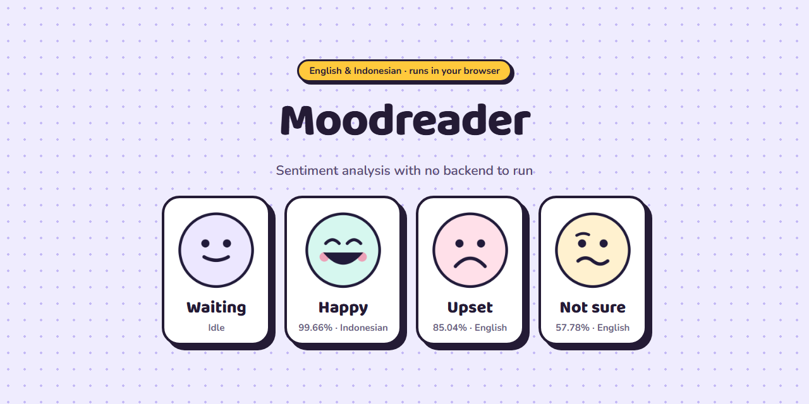
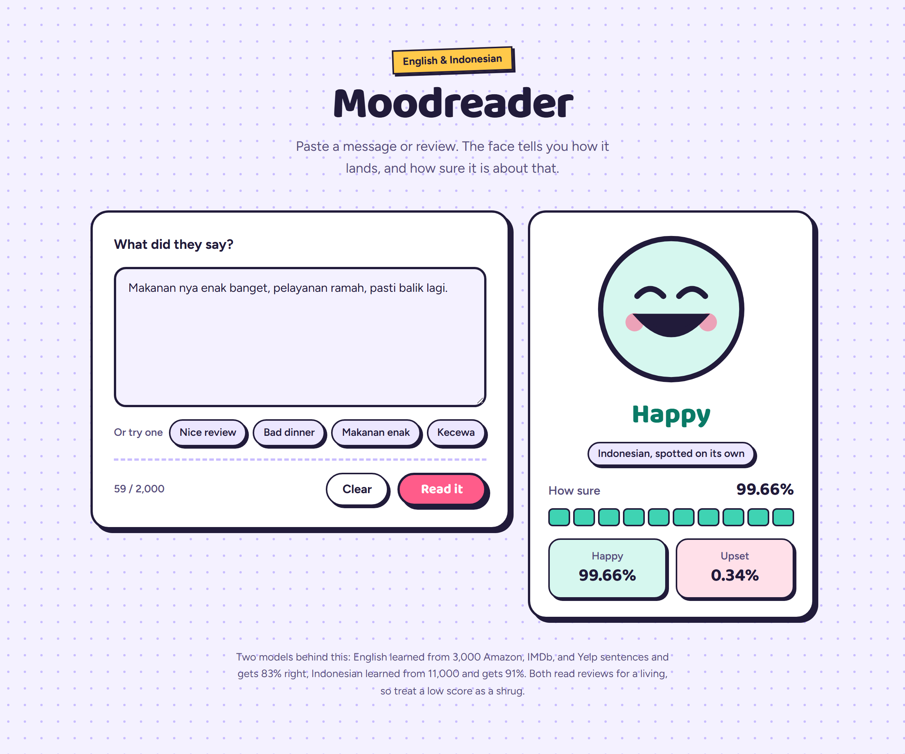
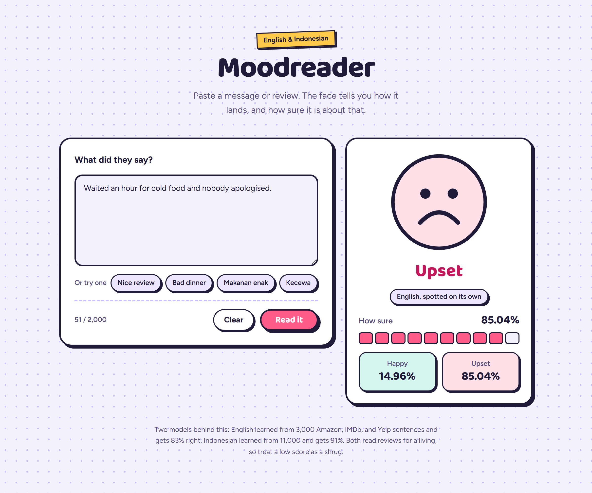
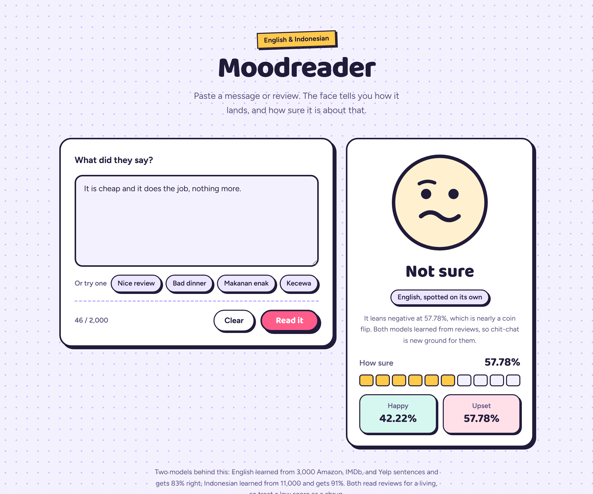
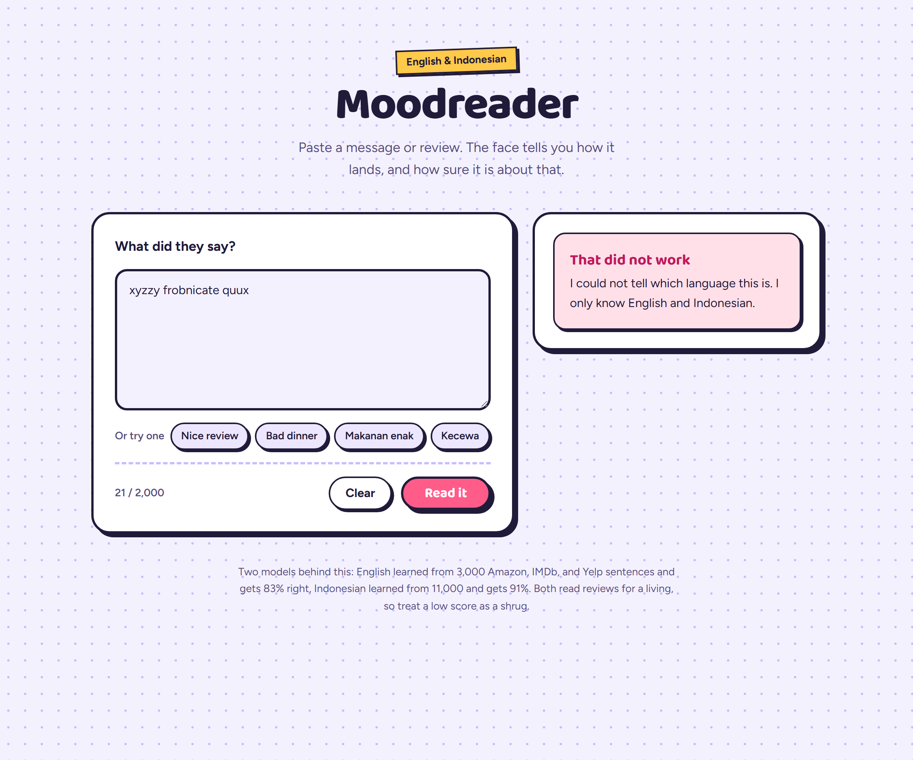

<div align="center">

# Moodreader

**Read the mood before you reply.**

Paste a review or message in English or Indonesian. The language is detected, then a TF-IDF and logistic regression model scores it as positive or negative and shows how certain it is.

The deployed site has no backend. The fitted weights are exported to JSON and the prediction runs in the browser, so there is nothing to host, nothing to wake up, and nothing to pay for.




</div>

---

## Screens

<table>
<tr>
<td width="50%"></td>
<td width="50%"></td>
</tr>
<tr>
<td align="center"><b>Happy</b> — Indonesian, detected</td>
<td align="center"><b>Upset</b> — English, detected</td>
</tr>
<tr>
<td width="50%"></td>
<td width="50%"></td>
</tr>
<tr>
<td align="center"><b>Not sure</b> — below 65%, reported as a shrug rather than a verdict</td>
<td align="center"><b>Unsupported</b> — neither language recognised, so no score is shown</td>
</tr>
</table>

## What it does

- **Classifies English and Indonesian text** as positive or negative with a confidence percentage.
- **Detects the language first**, so an Indonesian sentence is never scored by the English model.
- **Runs in the browser.** Each model is fetched on first use, so writing English never downloads the Indonesian weights, and nothing you type leaves the page.
- **Shows both class scores**, so a 51/49 split is visibly different from a 95/5 one.
- **Handles negation.** "Not good at all" lands on negative, because the model keeps words like *not*, *no*, *tidak*, and *banget* instead of stripping them as stop words.
- **Fails loudly, not silently.** Empty input, oversized input, text in an untrained language, and text with no known words each get their own message.

## Built with

| Technology | What it does here |
| --- | --- |
| [scikit-learn](https://scikit-learn.org) | Trains the TF-IDF and logistic regression pipeline, once per language. |
| [React](https://react.dev) 19 + [Vite](https://vite.dev) 8 | Interface, and the 40 lines that score a prediction from the exported weights. |
| [Tailwind CSS](https://tailwindcss.com) 4 | CSS-first theming through `@theme`, no config file. |
| [Flask](https://flask.palletsprojects.com) + [joblib](https://joblib.readthedocs.io) | Optional local API, useful for testing the Python side directly. Not deployed. |

## Getting started

### Prerequisites

- Python 3.10 or newer
- Node.js 20 or newer

Running the interface alone needs only Node. The exported weights are committed, so step 1 is for retraining, not for a first run.

### 1. Train the models (optional)

```bash
cd backend
pip install -r requirements.txt
python train.py
```

`train.py` downloads both datasets into `backend/data/`, trains one pipeline per language, prints a classification report for each, and writes four artifacts:

| Artifact | Consumer |
| --- | --- |
| `backend/model_en.joblib`, `model_id.joblib` | The local Flask API. Gitignored. |
| `frontend/public/models/model_*.json` | The browser. Committed, since Netlify runs no Python. |
| `frontend/src/markers.json` | The JS language detector, exported from `lang.py`. |
| `frontend/src/parity.json` | What scikit-learn predicts, for the JS parity check. |

Each model ends with a self-check that reloads the saved file and asserts two obvious cases, so a broken artifact fails here rather than at request time.

| Language | Dataset | Labelled texts |
| --- | --- | --- |
| English | [UCI Sentiment Labelled Sentences](https://archive.ics.uci.edu/dataset/331/sentiment+labelled+sentences) — Amazon, IMDb, Yelp | 3,000 |
| Indonesian | [IndoNLU SmSA](https://github.com/IndoNLP/indonlu) — Prosa document sentiment | 10,981 |

SmSA ships a third `neutral` label. It is dropped so both models stay binary and comparable; a neutral class needs its own UI treatment rather than a silent extra label.

Expected output:

```
en
3000 labelled texts  |  positive=1500  negative=1500
Accuracy: 0.8333
saved model_en.joblib
self-check passed
saved models/model_en.json (0.66 MB)

id
10981 labelled texts  |  positive=7151  negative=3830
Accuracy: 0.9135
saved model_id.joblib
self-check passed
saved models/model_id.json (4.33 MB)
saved markers.json
```

### 2. Run the interface

```bash
cd frontend
npm install
npm run dev
```

Open `http://localhost:5173`. No API needs to be running.

### 3. Verify the browser scorer

```bash
npm run check
```

Asserts that `predict.js` agrees with scikit-learn to 4 decimals on the cases `train.py` recorded, and that language detection matches `lang.py`. `npm run build` runs it first, so a drifted tokenizer cannot ship.

### 4. Run the Flask API (optional)

Only useful for exercising the Python side directly. The interface does not use it.

```bash
cd backend
python app.py
curl http://127.0.0.1:5000/health
```

## Local API

Kept for testing the Python side. The deployed site never calls it.

### `GET /health`

```json
{ "status": "ok", "languages": { "en": "English", "id": "Indonesian" } }
```

### `POST /predict`

```bash
curl -X POST http://127.0.0.1:5000/predict \
  -H "Content-Type: application/json" \
  -d '{"text": "The build quality is outstanding and it arrived two days early."}'
```

```json
{
  "sentiment": "positive",
  "confidence": 59.07,
  "scores": { "positive": 59.07, "negative": 40.93 },
  "language": "en",
  "languageName": "English",
  "detected": true
}
```

`detected` is `true` when the language came from detection, `false` when you supplied it. To skip detection, pass `language`:

```bash
curl -X POST http://127.0.0.1:5000/predict \
  -H "Content-Type: application/json" \
  -d '{"text": "Pelayanan nya cepat dan ramah.", "language": "id"}'
```

| Status | When |
| --- | --- |
| `200` | Prediction returned. |
| `400` | `text` missing, not a string, or blank; or `language` is not `en` or `id`. |
| `413` | `text` longer than 2,000 characters. |
| `422` | Language could not be determined and none was supplied. |

## How the model works

```
text ──→ word TF-IDF ──→ LogisticRegression (C=10) ──→ P(positive)
         unigrams + bigrams, min_df=1, sublinear tf
```

The same pipeline is trained twice, once per language. Two deliberate choices:

- **No stop word list.** The default English list removes *not*, *no*, and *very*, which carry the sentiment in short reviews. The Indonesian equivalents *tidak*, *nggak*, and *banget* matter the same way. Keeping them is worth roughly 8 points.
- **Words only, no character n-grams.** `char_wb` 3-5 grams catch typos like "terrrible" and were worth 1.3 points on English and nothing measurable on Indonesian, but they tripled the exported vocabulary. The browser is where this model actually runs, so the download won.

Held-out accuracy on a stratified 20% split:

| Model | Accuracy | Test size | Exported |
| --- | --- | --- | --- |
| English | **0.8333** | 600 | 0.66 MB |
| Indonesian | **0.9135** | 2,197 | 4.33 MB |

The Indonesian model scores higher mostly because it has 3.6x the training data. Both are trained on reviews, so casual conversation sits outside what they have seen. Treat low-confidence predictions as uncertain rather than wrong.

### Scoring in the browser

A fitted TF-IDF and logistic regression model is just numbers, so `predict.js` reimplements the scoring directly: lowercase, tokenize on `\b\w\w+\b`, build unigrams and bigrams, apply sublinear tf and idf, L2 normalise, then one dot product against the coefficients.

The risk is drift. A tokenizer that disagrees with `TfidfVectorizer` by one edge case would still return a plausible number, and nothing would look broken. So `train.py` records what scikit-learn predicts for a few sentences, and `npm run check` asserts the JS agrees to 4 decimals. Same for the detector: the marker lists live in `lang.py` and are exported, rather than retyped in JS.

Text with no words in the vocabulary reports zero matches rather than returning the intercept dressed up as a prediction.

### Language detection

`lang.py` counts function words from each language and picks the winner. The two languages share almost no function words, so a vote is accurate enough to route a request and adds no dependency.

A tie, or text with no markers at all, returns `unknown` and the API answers `422`. Guessing there would return a confident-looking score on a sentence neither model was trained for.

```bash
python lang.py   # runs the self-check
```

## Project structure

```
.
├── backend/
│   ├── train.py           Downloads data, trains, saves both models
│   ├── lang.py            Language detection, with a self-check
│   ├── app.py             Flask API: /health and /predict
│   ├── requirements.txt   Pinned Python dependencies
│   └── data/              Dataset cache (gitignored)
├── frontend/
│   ├── public/models/     Exported weights the browser fetches (committed)
│   ├── src/
│   │   ├── App.jsx        Form, the reactive face, error states
│   │   ├── predict.js     TF-IDF and logistic regression scoring, in JS
│   │   ├── predict.check.mjs  Parity check against scikit-learn
│   │   ├── lang.js        Language detection, port of lang.py
│   │   ├── markers.json   Marker lists, exported from lang.py
│   │   ├── parity.json    Expected scores, exported from train.py
│   │   ├── main.jsx       React entry point
│   │   └── index.css      Tailwind theme tokens
│   ├── index.html
│   └── vite.config.js
├── netlify.toml           Build and SPA fallback
└── docs/assets/           README screenshot
```

The `.joblib` models and `backend/data/` are gitignored: both are reproducible from `train.py`, and binary artifacts in git make diffs useless. The JSON exports are committed because Netlify runs no Python, so they cannot be regenerated at build time.

## Deploying

One static host, no backend. Connect the repository to Netlify and that is the whole deploy: `netlify.toml` sets the base directory, build command, publish directory, and the SPA fallback. No environment variables, no second service.

Any static host works the same way. Build with `npm run build` and serve `frontend/dist`.

## Notes on security

The weights are public by design. They are served as plain JSON so the browser can score with them, which means anyone can download the model. The training data is public too, so there is nothing in there that was not already available.

Text never leaves the page. There is no request to inspect, no server log to leak, and no API to rate limit.

The local Flask API is the one piece with an attack surface, and it is not deployed. Its CORS list is an allowlist rather than a wildcard, and it has no authentication, so keep it on localhost.

## Troubleshooting

| Problem | Fix |
| --- | --- |
| `Could not load the Indonesian model` | `frontend/public/models/` is missing. Run `python train.py`, or check the files reached your host. |
| `I could not tell which language this is` | The text has no English or Indonesian function words. |
| `None of these words are in my vocabulary` | Nothing in the text was in the training data. Expected for gibberish and very short input. |
| `npm run check` fails | `predict.js` and scikit-learn disagree. Retrain so the exports and the parity file come from the same run. |
| `Missing model_en.joblib, model_id.joblib` | Only affects `python app.py`. Run `python train.py` first. |
| Dataset download fails | Check your connection; `train.py` reuses `backend/data/` if the files are already there. |

## Future improvements

- Neutral class. SmSA already labels it; the English side needs a three-way dataset, and the UI needs its own treatment for it.
- More languages. Adding one is a dataset, a marker list, and a line in `train.py`.
- Per-word contribution highlighting. The coefficients are already in the browser, so this is a UI job rather than a modelling one.
- Model comparison against linear SVM and naive Bayes
- Trim the 4.33 MB Indonesian export. Raising `min_df` would cut most of the vocabulary; worth measuring against the accuracy it costs.

## License

[MIT](LICENSE)

## Author

Rizky Putra Ichfiandra — AI / ML enthusiast.
